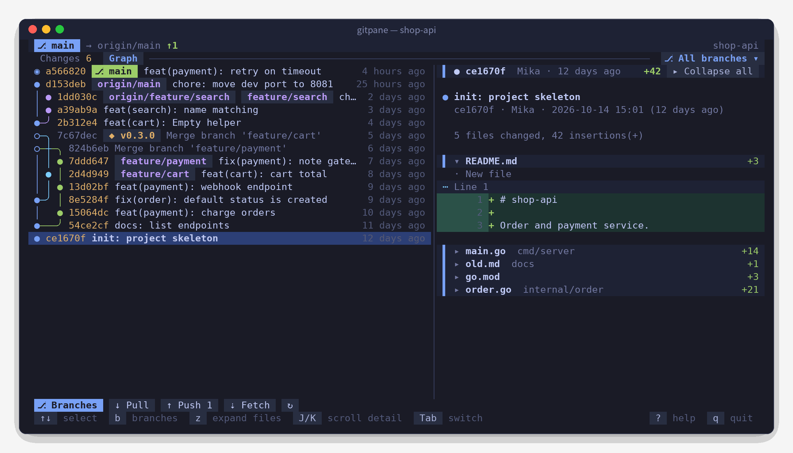
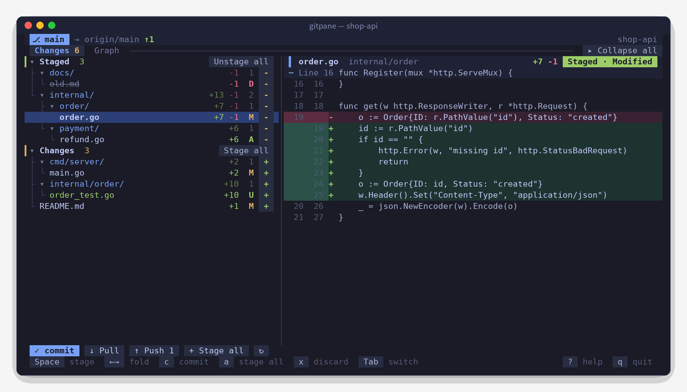
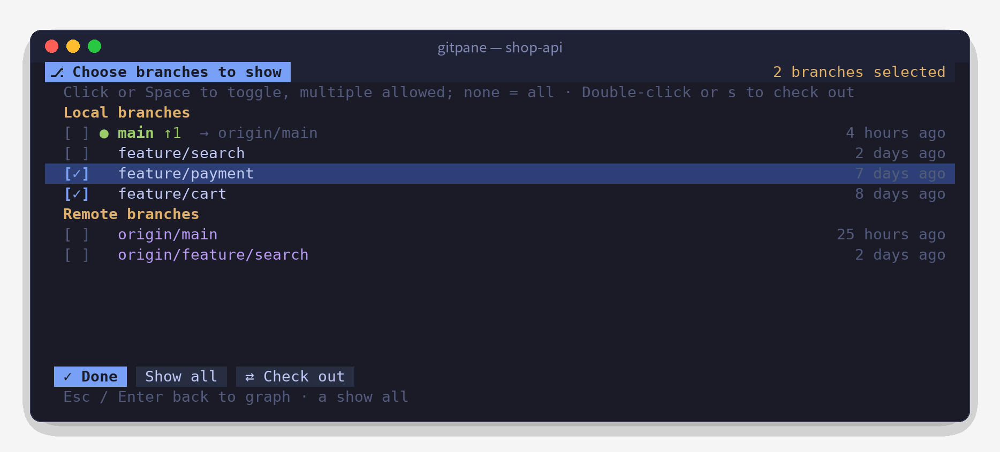

<div align="center">


<h1>Gitpane</h1>

<p><strong>A Git terminal UI you can drive with your mouse</strong></p>

<p>Change tree · Line-numbered diffs · Lane-based commit graph · Multi-branch filter<br>A single binary that just works on macOS, Linux and Windows</p>

[](https://github.com/0xBB2B/gitpane/releases)
[](https://github.com/0xBB2B/gitpane/actions/workflows/ci.yml)
[](go.mod)
[](https://goreportcard.com/report/github.com/0xBB2B/gitpane)
[](LICENSE)

<p>
  <a href="README.md">简体中文</a> ·
  <a href="README.zh-TW.md">繁體中文</a> ·
  <b>English</b> ·
  <a href="README.ja.md">日本語</a> ·
  <a href="README.ko.md">한국어</a>
</p>

<p>
  <a href="#quick-start">Quick start</a> ·
  <a href="#features">Features</a> ·
  <a href="#key-bindings">Key bindings</a> ·
  <a href="#faq">FAQ</a> ·
  <a href="#contributing">Contributing</a>
</p>



</div>

## Highlights

- **Point and click everywhere**: click a file to see its diff, click `+` / `-` to stage, click folders to collapse, scroll through history, double-click to switch branches — and the keyboard is just as fast.
- **A commit graph that's actually readable**: Gitpane lays out the lanes itself — one commit per row, forks and merges joined with rounded lines on the same row, and every branch keeps its color.
- **History by branch**: pick any mix of local and remote branches and the graph shows only those; it keeps loading as you scroll, all the way to the first commit.
- **Collapsible commit details**: one row per file with `+added -removed`; open the ones you care about and see the shape of a large commit at a glance.
- **A companion for AI coding**: refreshes every 2 seconds, so you see what Claude Code or Codex just changed; runs happily as a side panel in a split.
- **Five UI languages**: 简体中文, 繁體中文, English, 日本語 and 한국어 — picked from your system language, or set it yourself.
- **Stays out of the way**: never holds git locks, never blocks on a password prompt, and only needs the `git` already on your system.

## Quick start

**macOS** · Homebrew

```bash
brew tap 0xBB2B/gitpane https://github.com/0xBB2B/gitpane
brew install 0xBB2B/gitpane/gitpane
```

**Windows** · Scoop

```powershell
scoop bucket add gitpane https://github.com/0xBB2B/gitpane
scoop install gitpane
```

**Linux / from source**

```bash
go install github.com/0xBB2B/gitpane@latest
```

Or grab an archive for your platform from [Releases](https://github.com/0xBB2B/gitpane/releases).

Then run it inside any Git repository:

```bash
gitpane
```

Press `?` for every key binding, `q` to quit.

## Screenshots

<table>
  <tr>
    <td width="60%"></td>
    <td width="40%"></td>
  </tr>
  <tr>
    <td align="center"><sub>Changes: stage / unstage from a folder tree, diff on the right</sub></td>
    <td align="center"><sub>Branch picker: select several branches, double-click to switch</sub></td>
  </tr>
</table>

## Usage

```bash
gitpane                  # current directory
gitpane ~/code/foo       # a specific directory (any subdirectory of a repo works)
gitpane --lang en        # UI language: zh-CN / zh-TW / en / ja / ko
gitpane --depth 3        # outside a repo, look for repos up to 3 folder levels down (default 2, 0 = off)
gitpane --layout stack   # force the stacked layout; wide forces side by side
gitpane --embed          # panel mode: q doesn't quit, Ctrl+C twice closes (for split-pane setups)
gitpane --version
```

At 100 columns or wider the list and the detail pane sit side by side; narrower terminals get a stacked layout.
Drag the divider between them (in the stacked layout, drag the detail pane's title bar) to resize, or nudge it with `<` `>` and reset with `=`; each tab remembers its own split across restarts.

## Features

- **Changes**: conflicts / staged / unstaged groups shown as folder trees, each file with `+added -removed` and a status letter.
  Click a file for its diff, click `+` / `-` on the right to stage or unstage, click a folder's `+` to stage the whole folder, and use the buttons on group headers for bulk actions.
  After staging, the cursor moves on to the next file.
- **Diffs**: drawn by Gitpane itself with old and new line numbers, tinted added / removed lines and hunk positions; only the visible part is rendered, so large files stay smooth.
  Long lines are truncated by default; click “↩ Wrap” on the right of the detail header or press `w` to wrap them instead (remembered).
- **Graph**: a custom lane layout with one commit per row; forks and merges are joined on the same row with `╭ ╮ ╰ ╯ ├ ┤ ┴ ┼`, and each branch keeps its color.
  `◉` marks HEAD and `○` a merge commit (with a dimmed subject). HEAD, local branches, remote branches and tags are color-coded.
  Scrolling to the bottom loads more, so the entire history is reachable.
- **Branch filter**: all branches are shown by default. Click “⎇ All branches ▾” on the right of the tab bar (or press `b`) to open the picker,
  select any local or remote branches to see just their history, and click “✕ All” to reset. Double-click or press `s` in the picker to check a branch out (a tracking branch is created for remote branches).
- **Commit details**: the commit message plus one row per file (with `+added -removed`); click a file name to expand or collapse its changes.
  Single-file commits open expanded and multi-file commits start collapsed; `z` or the button in the header toggles them all.
- **Actions**: commit, pull, push (sets `-u origin HEAD` when there's no upstream), fetch, discard changes (confirmed twice), git init.
- **Languages**: the UI is available in 简体中文, 繁體中文, English, 日本語 and 한국어.
- **Subrepos**: start Gitpane in a folder that isn't a repository (a workspace full of projects, say) and it finds the repositories a few levels down.
  One repo opens straight away; several bring up a picker showing each repo's branch and change count (`/` to filter). Press `o` or click “⌂ Choose repository” at the bottom to switch at any time.
- Refreshes every 2 seconds, so changes made by other tools (an AI assistant writing code, say) show up right away.

## Key bindings

| Key | Action |
|---|---|
| `Tab` `1` `2` | Switch between Changes / Graph |
| `j` `k` `↑` `↓` / `g` `G` | Move / jump to top or bottom |
| `Space` | Stage / unstage the current row |
| `Enter` `←` `→` | Collapse / expand folders (`←` on a file jumps to its folder) |
| `z` | Changes: collapse / expand all folders; Graph: expand / collapse all files in commit details |
| `b` | Open the branch picker (Space to toggle, `a` show all, `s` check out, Esc to go back) |
| `o` | Switch between repos found in subfolders (when started outside a repo; `/` to filter, Enter to open) |
| `c` | Commit (input at the bottom, Enter to confirm, Esc to cancel) |
| `a` / `u` | Stage all / unstage all |
| `x` | Discard changes to the current file (press twice) |
| `p` / `P` / `f` | pull / push / fetch |
| `J` `K` | Scroll the detail pane |
| `w` | Wrap / truncate long lines in the detail pane (remembered) |
| `<` `>` / `=` | Move the divider between list and detail / reset it |
| `r` | Refresh now |
| `?` | Help |
| `q` / `Ctrl+C` | Quit (Ctrl+C twice with `--embed`) |

## Environment variables

| Variable | Description |
|---|---|
| `GITPANE_LANG` | UI language: `zh-CN` / `zh-TW` / `en` / `ja` / `ko` (`--lang` takes precedence) |
| `GITPANE_DEPTH` | Subrepo search depth, default `2`, `0` turns it off (`--depth` takes precedence) |
| `GITPANE_THEME` | `dark` / `light`, for when background detection gets it wrong |
| `GITPANE_NERD_FONT` | Set to `1` to show Nerd Font icons for files, folders and branches |

## FAQ

**How do I change the UI language?**
By default Gitpane follows your system language (it checks `LC_ALL`, `LC_MESSAGES` and `LANG`, plus the system settings on macOS and Windows) and falls back to Simplified Chinese when it can't tell.
To pin a language, pass `--lang en` or add `export GITPANE_LANG=en` to your shell profile (Windows: `setx GITPANE_LANG en`).

**How is this different from lazygit or tig?**
Gitpane is lighter: it focuses on the everyday loop — stage, commit, read diffs, browse history — with direct mouse control and a commit graph that's easy to read, so it can live in a side pane all day. For heavy lifting like interactive rebase or cherry-pick, lazygit is still the better tool.

**Will it fight my editor or AI assistant for the git lock?**
No. Gitpane reads status with `GIT_OPTIONAL_LOCKS=0`, so it never takes `index.lock`.

**What if push / pull needs a password?**
Gitpane sets `GIT_TERMINAL_PROMPT=0`, so it reports an error instead of freezing on a prompt. Use an SSH key or a credential helper.

**macOS says the developer can't be verified?**
The Homebrew install takes care of this. For a binary you downloaded yourself, run `xattr -d com.apple.quarantine ./gitpane` once.

**Garbled layout or no mouse on Windows?**
Use [Windows Terminal](https://aka.ms/terminal). The legacy cmd console has incomplete support for mouse input and box-drawing characters.

**Colors look off / I want icons?**
Set `GITPANE_THEME=light|dark` to force a theme. If your terminal uses a Nerd Font, set `GITPANE_NERD_FONT=1` for file icons.

## Project layout

```
main.go                  CLI flags, version info, language selection
docs/                    logo and localized screenshots
.goreleaser.yaml         release config (6 platforms, GitHub Release, Homebrew cask, Scoop)
.github/workflows/
  ci.yml                 push / PR: tests on three OSes + a release dry run
  release.yml            v* tag: the real release
internal/i18n/           i18n: language detection + translation tables (tests catch missing strings)
internal/gitx/           git plumbing (status, numstat, diff, commit, remotes, branches)
  graph.go               lane layout for the commit graph (unit tested)
  discover.go            subrepo discovery (unit tested)
internal/ui/
  model.go / update.go   state, async loading, keyboard and mouse handling
  view.go                layout (stacked / side by side) and rendering; the same layout drives hit-testing
  diffview.go            parsing and drawing of diffs, commit details and graph rows
  picker.go              branch picker
  repos.go               repository picker and switching
  split.go               dragging and saving the list / detail divider
  tree.go                changed files → folder tree with guide lines
  theme.go               Tokyo Night dark / light palettes, icons
```

## Contributing

Issues and pull requests are welcome.

```bash
git clone https://github.com/0xBB2B/gitpane && cd gitpane
go test ./...        # unit tests (graph layout, control-character sanitizing, translation coverage)
go run . ~/some/repo # run it locally
```

Please use [Conventional Commits](https://www.conventionalcommits.org/en/v1.0.0/) (`feat:`, `fix:`, `docs:` …) — release notes are generated from them.

**Translations**: UI strings are written in Simplified Chinese in the code and wrapped in `i18n.T("…")`; the other languages live in `internal/i18n/catalog_*.go`.
After adding a string, `go test ./internal/i18n` lists the missing translations. If a translation reads awkwardly, a PR is very welcome.

## Releasing (maintainers)

Releases are automated with GitHub Actions and [GoReleaser](https://goreleaser.com). Pushing a `v*` tag
builds six binaries (macOS / Linux / Windows × amd64 / arm64), creates the GitHub Release,
and commits the Homebrew cask to `Casks/` and the Scoop manifest to `bucket/` on `main`.

This repository doubles as the Homebrew tap and the Scoop bucket, so there's no extra repository and no extra token.

### Notes

- After each release a bot pushes a `chore: …` commit to `main`; `git pull` before your next push.
- If `main` is branch-protected, allow GitHub Actions to push, otherwise the cask / manifest update fails.
- `Casks/` and `bucket/` are generated — don't edit them by hand.

### Cutting a release

```bash
git tag v0.1.0
git push origin v0.1.0
```

Follow the release run on the Actions page. Tags with a suffix such as `-rc` / `-beta` (e.g. `v0.2.0-rc1`)
are marked as pre-releases and are not pushed to brew / scoop.

### Local dry run

```bash
goreleaser check                                       # validate the config
goreleaser release --snapshot --clean --skip=publish   # build everything into dist/ without publishing
```

## Acknowledgements

- [Bubble Tea](https://github.com/charmbracelet/bubbletea) / [Lip Gloss](https://github.com/charmbracelet/lipgloss) / [Bubbles](https://github.com/charmbracelet/bubbles): the TUI framework
- [Tokyo Night](https://github.com/enkia/tokyo-night-vscode-theme): color inspiration
- [GoReleaser](https://goreleaser.com): cross-platform releases

## License

[MIT](LICENSE) © 0xBB2B
