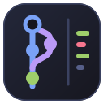
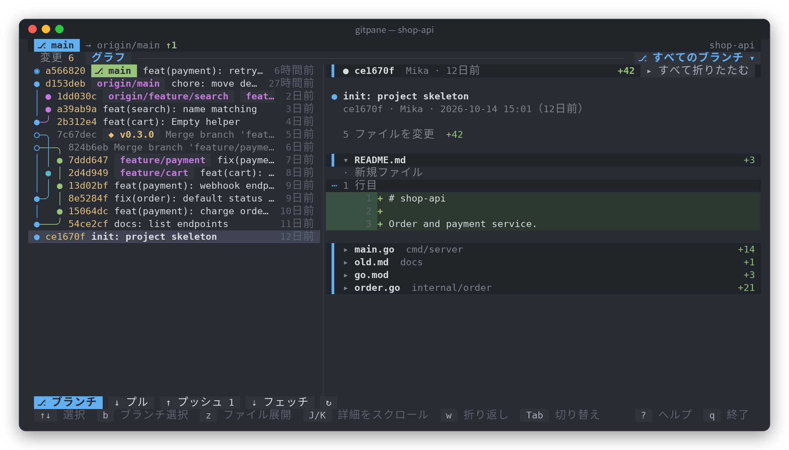
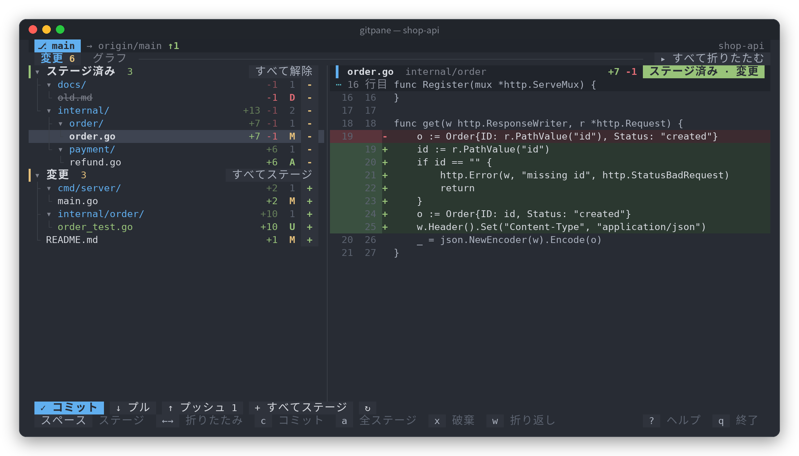
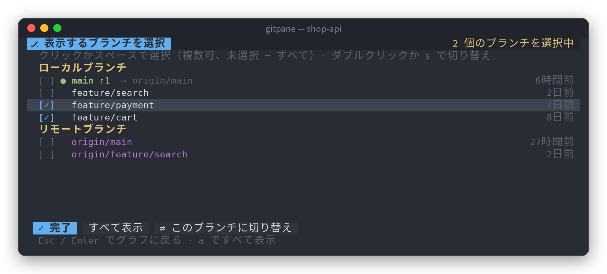

<div align="center">



<h1>Gitpane</h1>

<p><strong>マウスで操作できる Git のターミナル UI</strong></p>

<p>変更ツリー · 行番号付き diff · レーン表示のコミットグラフ · 複数ブランチの絞り込み<br>シングルバイナリですぐ使える、macOS / Linux / Windows 対応</p>

[](https://github.com/0xBB2B/gitpane/releases)
[](https://github.com/0xBB2B/gitpane/actions/workflows/ci.yml)
[](go.mod)
[](https://goreportcard.com/report/github.com/0xBB2B/gitpane)
[](LICENSE)

<p>
  <a href="README.md">简体中文</a> ·
  <a href="README.zh-TW.md">繁體中文</a> ·
  <a href="README.en.md">English</a> ·
  <b>日本語</b> ·
  <a href="README.ko.md">한국어</a>
</p>

<p>
  <a href="#クイックスタート">クイックスタート</a> ·
  <a href="#機能">機能</a> ·
  <a href="#キー操作">キー操作</a> ·
  <a href="#よくある質問">よくある質問</a> ·
  <a href="#コントリビュート">コントリビュート</a>
</p>



</div>

## 特長

- **ほぼすべてマウスで操作**：ファイルをクリックして diff を表示、`+` / `-` でステージ、フォルダをクリックして折りたたみ、ホイールで履歴をたどり、ダブルクリックでブランチを切り替え。もちろんキーボードでも同じように速く操作できます。
- **本当に読みやすいコミットグラフ**：レーンの配置を独自に計算。1 コミット 1 行で、分岐やマージは同じ行の中で角丸の線でつながり、ブランチごとの色も変わりません。
- **ブランチ単位で履歴を見る**：ローカル・リモートのブランチを自由に複数選択し、気になるブランチだけをグラフに表示。スクロールすると自動で読み込み、最初のコミットまでたどれます。
- **コミット詳細は折りたたみ式**：ファイルごとに `+追加 -削除` 付きの 1 行。必要なファイルだけ開けるので、大きなコミットも全体像がひと目でわかります。
- **AI と一緒にコーディングするときに**：2 秒ごとに自動更新するので、Claude Code や Codex が何を変えたかすぐにわかります。画面分割の片側にパネルとして置いておくのに向いています。
- **5 つの表示言語**：简体中文・繁體中文・English・日本語・한국어。システムの言語から自動で選ばれ、手動でも指定できます。
- **邪魔をしない**：git のロックを取らず、パスワード入力で止まらず、必要なのはシステムの `git` だけです。

## クイックスタート

**macOS** · Homebrew

```bash
brew tap 0xBB2B/gitpane https://github.com/0xBB2B/gitpane
brew install 0xBB2B/gitpane/gitpane
```

**Windows** · Scoop

```powershell
scoop bucket add gitpane https://github.com/0xBB2B/gitpane
scoop install gitpane
```

**Linux / ソースから**

```bash
go install github.com/0xBB2B/gitpane@latest
```

[Releases](https://github.com/0xBB2B/gitpane/releases) から各プラットフォーム向けのアーカイブをダウンロードすることもできます。

あとは任意の Git リポジトリの中で実行するだけです：

```bash
gitpane
```

`?` ですべてのキー操作を表示、`q` で終了します。

## スクリーンショット

<table>
  <tr>
    <td width="60%"></td>
    <td width="40%"></td>
  </tr>
  <tr>
    <td align="center"><sub>変更：フォルダツリーでステージ / 解除、右側ですぐに diff を確認</sub></td>
    <td align="center"><sub>ブランチ選択：複数選択、ダブルクリックで切り替え</sub></td>
  </tr>
</table>

## 使い方

```bash
gitpane                  # カレントディレクトリ
gitpane ~/code/foo       # ディレクトリを指定（リポジトリ内のどのサブディレクトリでも可）
gitpane --lang ja        # 表示言語：zh-CN / zh-TW / en / ja / ko
gitpane --depth 3        # リポジトリ外で起動したとき、3 階層下までリポジトリを探す（既定 2、0 で無効）
gitpane --layout stack   # 上下レイアウトに固定。wide で左右に固定
gitpane --embed          # パネルモード：q で終了せず、Ctrl+C 2 回で閉じる（画面分割ツールへの埋め込み用）
gitpane --version
```

幅が 100 桁以上のときはリストと詳細を左右に並べ、それより狭いと自動的に上下レイアウトになります。
中央の境界線（上下レイアウトでは詳細ペインのタイトルバー）をドラッグすると比率を変えられます。`<` `>` で微調整、`=` で既定に戻せます。比率はタブごとに保存され、次回の起動でも使われます。

## 機能

- **変更**：コンフリクト / ステージ済み / 変更の 3 グループをフォルダツリーで表示。各ファイルに `+追加 -削除` とステータス記号を表示します。
  ファイルをクリックで diff、右側の `+` / `-` でステージ / 解除、フォルダの `+` でフォルダごとステージ、グループ見出し右のボタンでまとめて操作できます。
  ステージ後はカーソルが自動で次のファイルに移ります。
- **diff**：独自に描画。新旧の行番号、追加 / 削除行の背景色、hunk の位置を表示し、見えている部分だけを描くので大きなファイルでも軽快です。
  長い行は既定で折り返して全文表示。`w` で切り詰め表示に切り替えられます（設定は保存）。
- **グラフ**：独自のレーン配置で 1 コミット 1 行。分岐 / マージは `╭ ╮ ╰ ╯ ├ ┤ ┴ ┼` で同じ行の中でつながり、ブランチごとの色は固定です。
  `◉` が HEAD、`○` がマージコミット（タイトルは控えめに表示）。HEAD / ローカルブランチ / リモートブランチ / タグは色分けされます。
  末尾までスクロールするとさらに読み込むので、履歴全体をたどれます。
- **ブランチの絞り込み**：既定ではすべてのブランチを表示。タブバー右の「⎇ すべてのブランチ ▾」をクリック（または `b`）するとブランチ選択画面が開き、
  ローカル / リモートのブランチを複数選んでその履歴だけを表示できます。「✕ すべて」で元に戻ります。選択画面でダブルクリックまたは `s` を押すとそのブランチに切り替えます（リモートブランチの場合は追跡ブランチを自動作成）。
- **コミット詳細**：コミットメッセージ + ファイルごとに 1 行（`+追加 -削除` 付き）。ファイル名をクリックすると変更を展開 / 折りたたみます。
  変更が 1 ファイルなら最初から展開、複数ファイルなら最初は折りたたみ。`z` または見出し右のボタンですべて展開 / 折りたたみます。
- **操作**：コミット、pull、push（アップストリームがなければ `-u origin HEAD` を自動設定）、fetch、変更の破棄（2 回確認）、git init。
- **多言語**：简体中文・繁體中文・English・日本語・한국어 の UI に対応。
- **サブリポジトリ**：Git リポジトリではないフォルダ（たくさんのプロジェクトを置いたワークスペースなど）で起動すると、数階層下のサブフォルダからリポジトリを探します。
  1 つだけならそのまま開き、複数あれば選択画面（各リポジトリのブランチと変更数を表示、`/` で絞り込み）を表示します。あとは `o` キーか下部の「⌂ リポジトリを選択」でいつでも切り替えられます。
- 2 秒ごとに自動更新するので、ほかのツール（たとえばコードを書いている AI アシスタント）による変更もすぐに反映されます。

## キー操作

| キー | 動作 |
|---|---|
| `Tab` `1` `2` | 変更 / グラフを切り替え |
| `j` `k` `↑` `↓` / `g` `G` | 移動 / 先頭・末尾へ |
| `スペース` | 現在の行をステージ / 解除 |
| `Enter` `←` `→` | フォルダを折りたたむ / 展開（ファイル上で `←` を押すと親フォルダへ） |
| `z` | 変更画面：すべてのフォルダを折りたたむ / 展開、グラフ画面：コミット詳細のファイルをすべて展開 / 折りたたみ |
| `b` | ブランチ選択画面を開く（スペースで選択、`a` ですべて表示、`s` で切り替え、Esc で戻る） |
| `o` | サブフォルダ内のリポジトリを切り替え（リポジトリ外で起動したとき。`/` で絞り込み、Enter で開く） |
| `c` | コミット（下部の入力欄、Enter で確定、Esc でキャンセル） |
| `a` / `u` | すべてステージ / すべて解除 |
| `x` | 現在のファイルの変更を破棄（2 回押して確定） |
| `p` / `P` / `f` | pull / push / fetch |
| `J` `K` | 詳細ペインをスクロール |
| `w` | 詳細ペインの長い行を折り返す / 切り詰める（設定は保存） |
| `<` `>` / `=` | リストと詳細の境界線を移動 / 既定に戻す |
| `r` | 今すぐ更新 |
| `?` | ヘルプ |
| `q` / `Ctrl+C` | 終了（`--embed` 時は Ctrl+C を 2 回） |

## 環境変数

| 変数 | 説明 |
|---|---|
| `GITPANE_LANG` | 表示言語：`zh-CN` / `zh-TW` / `en` / `ja` / `ko`（`--lang` が優先） |
| `GITPANE_DEPTH` | サブリポジトリを探す深さ。既定 `2`、`0` で無効（`--depth` が優先） |
| `GITPANE_THEME` | `dark` / `light`。背景色の自動判定がうまくいかないときに指定 |
| `GITPANE_NERD_FONT` | `1` にすると Nerd Font のファイル / フォルダ / ブランチアイコンを表示 |

## よくある質問

**表示言語を変えるには？**
既定ではシステムの言語に合わせます（`LC_ALL`・`LC_MESSAGES`・`LANG` の順に確認し、macOS と Windows ではシステム設定も参照）。判定できない場合は簡体字中国語になります。
言語を固定したい場合は、毎回 `--lang ja` を付けるか、シェルの設定ファイルに `export GITPANE_LANG=ja` を追加してください（Windows：`setx GITPANE_LANG ja`）。

**lazygit や tig との違いは？**
Gitpane はより軽量です。ステージ・コミット・diff の確認・履歴の閲覧といった日常の操作に絞り、マウスでの直接操作と読みやすいコミットグラフを重視しているので、画面分割の片側に常駐させておくのに向いています。インタラクティブ rebase や cherry-pick などの高度な操作には、引き続き lazygit がおすすめです。

**エディタや AI アシスタントと git のロックを取り合いませんか？**
取り合いません。Gitpane は `GIT_OPTIONAL_LOCKS=0` を設定してステータスを読むので、`index.lock` を占有しません。

**push / pull でパスワードが必要な場合は？**
Gitpane は `GIT_TERMINAL_PROMPT=0` を設定しているため、入力待ちで固まらずにエラーを表示します。SSH 鍵か credential helper を使ってください。

**macOS で「開発元を検証できません」と表示される？**
Homebrew でインストールした場合は自動で対処されます。手動でダウンロードしたバイナリの場合は、一度だけ `xattr -d com.apple.quarantine ./gitpane` を実行してください。

**Windows で表示が崩れる / マウスが効かない？**
[Windows Terminal](https://aka.ms/terminal) を使ってください。古い cmd コンソールはマウス入力と罫線文字のサポートが不十分です。

**配色がおかしい / アイコンを表示したい？**
`GITPANE_THEME=light|dark` で配色を指定できます。ターミナルで Nerd Font を使っている場合は、`GITPANE_NERD_FONT=1` でファイルアイコンを表示できます。

## プロジェクト構成

```
main.go                  コマンドライン引数、バージョン情報、言語の選択
docs/                    ロゴと各言語のスクリーンショット
.goreleaser.yaml         リリース設定（6 プラットフォームのビルド、Release、Homebrew cask、Scoop）
.github/workflows/
  ci.yml                 push / PR：3 つの OS でのテスト + リリースのリハーサル
  release.yml            v* タグの push：正式リリース
internal/i18n/           多言語化：言語の判定 + 各言語の翻訳テーブル（翻訳漏れはテストで検出）
internal/gitx/           git コマンドのラッパー（status、numstat、diff、コミット、リモート、ブランチ）
  graph.go               コミットグラフのレーン配置（ユニットテスト付き）
  discover.go            サブリポジトリの探索（ユニットテスト付き）
internal/ui/
  model.go / update.go   状態、非同期読み込み、キーボード・マウス操作
  view.go                レイアウト（上下 / 左右）と描画。同じレイアウト関数でクリック判定も行う
  diffview.go            diff / コミット詳細 / グラフ行の解析と描画
  picker.go              ブランチ選択画面
  repos.go               リポジトリ選択画面と切り替え
  split.go               リスト / 詳細の境界線のドラッグと保存
  tree.go                変更ファイル → 罫線付きのフォルダツリー
  theme.go               One Monokai / One Light のダーク / ライト配色、アイコン
```

## コントリビュート

Issue や Pull Request を歓迎します。

```bash
git clone https://github.com/0xBB2B/gitpane && cd gitpane
go test ./...        # ユニットテスト（グラフのレーン配置、制御文字の除去、翻訳の網羅性など）
go run . ~/some/repo # ローカルで実行
```

コミットメッセージは [Conventional Commits](https://www.conventionalcommits.org/ja/v1.0.0/)（`feat:`、`fix:`、`docs:` …）の形式でお願いします。リリースノートはこれをもとに自動生成されます。

**翻訳**：UI の文言はコード上では簡体字中国語の原文で書き、`i18n.T("…")` で囲んでいます。ほかの言語の訳文は `internal/i18n/catalog_*.go` にあります。
文言を追加したら `go test ./internal/i18n` で不足している翻訳が一覧表示されます。不自然な訳を見つけたら、ぜひ PR をお送りください。

## リリース（メンテナー向け）

リリースは GitHub Actions + [GoReleaser](https://goreleaser.com) で自動化されています。`v*` タグを push すると、
macOS / Linux / Windows × amd64 / arm64 の 6 種類をビルドして GitHub Release を作成し、
Homebrew cask をこのリポジトリの `Casks/` に、Scoop マニフェストを `bucket/` に書き込んで `main` にコミットします。

このリポジトリ自体が Homebrew tap と Scoop bucket を兼ねているので、別のリポジトリも追加のトークンも不要です。

### 注意点

- リリースのたびにボットが `chore: …` コミットを `main` に push します。次に push する前に `git pull` してください。
- `main` にブランチ保護を設定している場合は、GitHub Actions からの push を許可してください。許可しないと cask / マニフェストの更新に失敗します。
- `Casks/` と `bucket/` は自動生成されるので、手で編集しないでください。

### リリース手順

```bash
git tag v0.1.0
git push origin v0.1.0
```

進行状況は Actions ページで確認できます。`-rc` / `-beta` などの接尾辞が付いたタグ（例：`v0.2.0-rc1`）は
プレリリースとして扱われ、brew / scoop には反映されません。

### ローカルでのリハーサル

```bash
goreleaser check                                       # 設定をチェック
goreleaser release --snapshot --clean --skip=publish   # dist/ に成果物を作るだけで公開はしない
```

## 謝辞

- [Bubble Tea](https://github.com/charmbracelet/bubbletea) / [Lip Gloss](https://github.com/charmbracelet/lipgloss) / [Bubbles](https://github.com/charmbracelet/bubbles)：TUI フレームワーク
- [One Monokai](https://github.com/azemoh/vscode-one-monokai)・[One Light](https://github.com/atom/atom/tree/master/packages/one-light-syntax)：配色
- [GoReleaser](https://goreleaser.com)：クロスプラットフォームのリリース

## ライセンス

[MIT](LICENSE) © 0xBB2B
