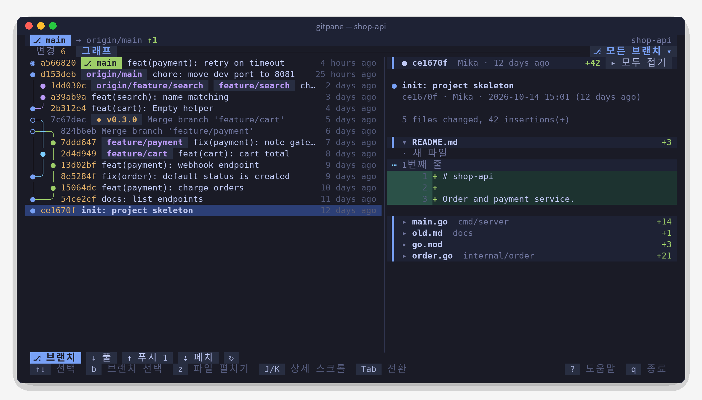
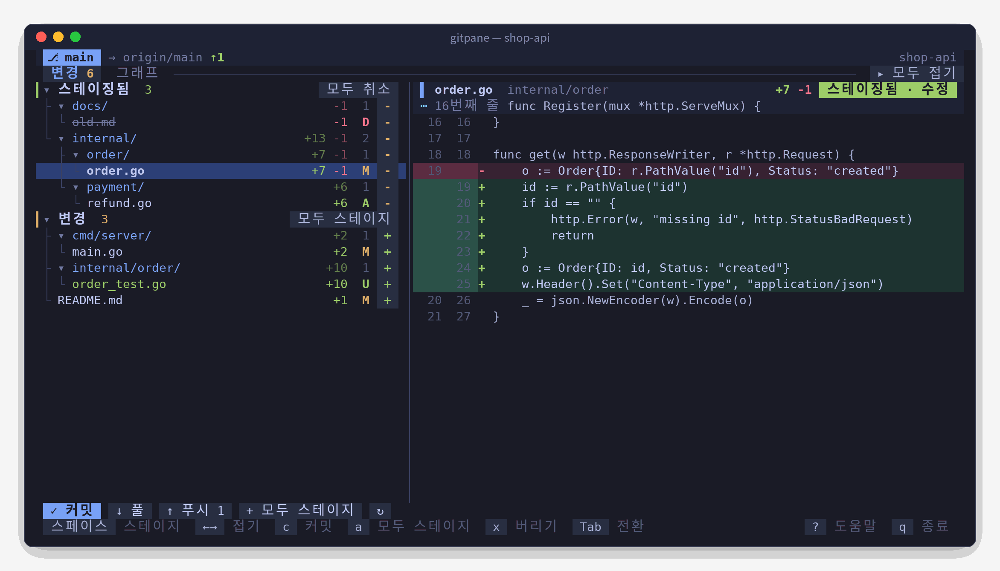
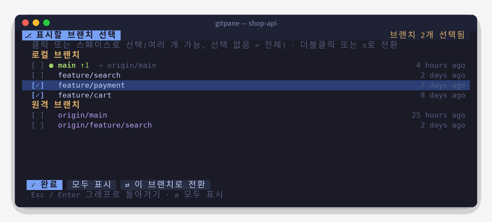

<div align="center">


<h1>Gitpane</h1>

<p><strong>마우스로 조작하는 Git 터미널 UI</strong></p>

<p>변경 트리 · 줄 번호가 있는 diff · 레인 방식의 커밋 그래프 · 여러 브랜치 필터<br>단일 바이너리로 바로 사용, macOS / Linux / Windows 지원</p>

[](https://github.com/0xBB2B/gitpane/releases)
[](https://github.com/0xBB2B/gitpane/actions/workflows/ci.yml)
[](go.mod)
[](https://goreportcard.com/report/github.com/0xBB2B/gitpane)
[](LICENSE)

<p>
  <a href="README.md">简体中文</a> ·
  <a href="README.zh-TW.md">繁體中文</a> ·
  <a href="README.en.md">English</a> ·
  <a href="README.ja.md">日本語</a> ·
  <b>한국어</b>
</p>

<p>
  <a href="https://gitpane.0xbb.me/?lang=ko">공식 사이트</a> ·
  <a href="#빠른-시작">빠른 시작</a> ·
  <a href="#기능">기능</a> ·
  <a href="#단축키">단축키</a> ·
  <a href="#자주-묻는-질문">자주 묻는 질문</a> ·
  <a href="#기여하기">기여하기</a>
</p>



</div>

## 특징

- **어디서나 마우스로 클릭**: 파일을 클릭해 diff 보기, `+` / `-`로 스테이지, 폴더 클릭으로 접기, 휠로 기록 탐색, 더블클릭으로 브랜치 전환. 물론 키보드로도 똑같이 빠릅니다.
- **정말 읽기 쉬운 커밋 그래프**: 레인 배치를 직접 계산합니다. 커밋 하나에 한 줄, 분기와 병합은 같은 줄 안에서 둥근 선으로 이어지고 브랜치마다 색이 고정됩니다.
- **브랜치별 기록 보기**: 로컬·원격 브랜치를 자유롭게 여러 개 골라 원하는 브랜치만 그래프에 표시합니다. 스크롤하면 자동으로 더 불러와 첫 커밋까지 볼 수 있습니다.
- **접을 수 있는 커밋 상세**: 파일마다 `+추가 -삭제`가 붙은 한 줄. 필요한 파일만 펼쳐 볼 수 있어 큰 커밋도 한눈에 파악됩니다.
- **AI와 함께 코딩할 때**: 2초마다 자동으로 새로고침하므로 Claude Code나 Codex가 무엇을 바꿨는지 바로 보입니다. 화면 분할 한쪽에 패널로 띄워 두기 좋습니다.
- **5가지 표시 언어**: 简体中文, 繁體中文, English, 日本語, 한국어. 시스템 언어에 맞춰 자동으로 선택되며 직접 지정할 수도 있습니다.
- **방해하지 않음**: git 잠금을 잡지 않고, 비밀번호 입력에서 멈추지 않으며, 시스템에 있는 `git`만 있으면 됩니다.

## 빠른 시작

**macOS** · Homebrew

```bash
brew tap 0xBB2B/gitpane https://github.com/0xBB2B/gitpane
brew install 0xBB2B/gitpane/gitpane
```

**Windows** · Scoop

```powershell
scoop bucket add gitpane https://github.com/0xBB2B/gitpane
scoop install gitpane
```

**Linux / 소스에서 설치**

```bash
go install github.com/0xBB2B/gitpane@latest
```

[Releases](https://github.com/0xBB2B/gitpane/releases)에서 플랫폼별 압축 파일을 내려받을 수도 있습니다.

그다음 아무 Git 저장소 안에서 실행하면 됩니다:

```bash
gitpane
```

`?`를 누르면 모든 단축키를 볼 수 있고, `q`로 종료합니다.

## 스크린샷

<table>
  <tr>
    <td width="60%"></td>
    <td width="40%"></td>
  </tr>
  <tr>
    <td align="center"><sub>변경: 폴더 트리에서 스테이지 / 취소, 오른쪽에서 바로 diff 확인</sub></td>
    <td align="center"><sub>브랜치 선택: 여러 개 선택, 더블클릭으로 전환</sub></td>
  </tr>
</table>

## 사용법

```bash
gitpane                  # 현재 디렉터리
gitpane ~/code/foo       # 디렉터리 지정 (저장소 안의 어느 하위 디렉터리든 가능)
gitpane --lang ko        # 표시 언어: zh-CN / zh-TW / en / ja / ko
gitpane --depth 3        # 저장소 밖에서 실행하면 하위 폴더 3단계까지 저장소를 찾음 (기본값 2, 0 = 끄기)
gitpane --layout stack   # 위아래 레이아웃으로 고정, wide는 좌우로 고정
gitpane --embed          # 패널 모드: q로 종료되지 않고 Ctrl+C 두 번으로 닫힘 (화면 분할 도구에 내장할 때)
gitpane --version
```

너비가 100열 이상이면 목록과 상세를 좌우로 나란히 표시하고, 더 좁으면 자동으로 위아래 레이아웃이 됩니다.
가운데 구분선(위아래 레이아웃에서는 상세 영역의 제목 표시줄)을 드래그하면 비율을 바꿀 수 있고, `<` `>`로 미세 조정, `=`로 기본값 복원이 됩니다. 비율은 탭마다 저장되어 다음 실행 때도 유지됩니다.

## 기능

- **변경**: 충돌 / 스테이징됨 / 변경 세 그룹을 폴더 트리로 표시하고, 파일마다 `+추가 -삭제`와 상태 문자를 보여 줍니다.
  파일을 클릭하면 diff, 오른쪽 `+` / `-`로 스테이지 / 취소, 폴더의 `+`로 폴더 전체를 스테이지하고, 그룹 제목 오른쪽 버튼으로 일괄 작업할 수 있습니다.
  스테이지한 뒤에는 커서가 자동으로 다음 파일로 이동합니다.
- **diff**: 직접 그립니다. 이전 / 이후 줄 번호, 추가 / 삭제 줄 배경색, hunk 위치를 표시하고, 보이는 부분만 그려서 큰 파일도 가볍습니다.
  긴 줄은 기본적으로 줄바꿈해 전부 표시합니다. `w`로 잘라서 표시하도록 바꿀 수 있습니다 (설정 유지).
- **그래프**: 독자적인 레인 배치로 커밋 하나에 한 줄. 분기 / 병합은 `╭ ╮ ╰ ╯ ├ ┤ ┴ ┼`로 같은 줄 안에서 이어지고 브랜치마다 색이 고정됩니다.
  `◉`는 HEAD, `○`는 병합 커밋(제목은 흐리게 표시)입니다. HEAD / 로컬 브랜치 / 원격 브랜치 / 태그는 색으로 구분됩니다.
  끝까지 스크롤하면 더 불러오므로 전체 기록을 볼 수 있습니다.
- **브랜치 필터**: 기본으로 모든 브랜치를 표시합니다. 탭 바 오른쪽의 '⎇ 모든 브랜치 ▾'를 클릭(또는 `b`)하면 브랜치 선택 화면이 열리고,
  로컬 / 원격 브랜치를 여러 개 골라 그 기록만 볼 수 있습니다. '✕ 전체'를 누르면 원래대로 돌아갑니다. 선택 화면에서 더블클릭하거나 `s`를 누르면 해당 브랜치로 전환합니다(원격 브랜치는 추적 브랜치를 자동으로 만듭니다).
- **커밋 상세**: 커밋 메시지 + 파일마다 한 줄(`+추가 -삭제` 포함). 파일 이름을 클릭하면 변경 사항을 펼치거나 접습니다.
  파일이 하나뿐이면 처음부터 펼쳐지고, 여러 개면 처음에는 접혀 있습니다. `z` 또는 제목 표시줄 오른쪽 버튼으로 모두 펼치거나 접습니다.
- **작업**: 커밋, pull, push(업스트림이 없으면 `-u origin HEAD` 자동 설정), fetch, 변경 사항 버리기(두 번 확인), git init.
- **다국어**: 简体中文, 繁體中文, English, 日本語, 한국어 UI를 지원합니다.
- **하위 저장소**: Git 저장소가 아닌 폴더(프로젝트를 여러 개 둔 작업 공간 등)에서 실행하면 몇 단계 아래 하위 폴더에서 저장소를 찾습니다.
  하나뿐이면 바로 열고, 여러 개면 선택 화면(저장소별 브랜치와 변경 수 표시, `/`로 필터)을 띄웁니다. 이후 `o`를 누르거나 오른쪽 위 저장소 이름을 클릭해 언제든 전환할 수 있습니다.
- **작업 트리**: `git worktree`로 여러 브랜치를 동시에 개발할 때는 변경 화면 탭 바 오른쪽에 「⎇ 작업 트리: 브랜치 ▾」 버튼이 나타납니다(`t` 키도 가능).
  모든 작업 트리와 각각의 변경 수를 보여 주고, 전환하면 그 작업 트리의 커밋하지 않은 변경을 보고, 스테이징하고, 커밋할 수 있습니다. 그래프는 공유되므로 위치와 필터는 그대로 유지됩니다.
- 2초마다 자동으로 새로고침하므로 다른 도구(예: 코드를 작성 중인 AI 어시스턴트)가 바꾼 내용도 바로 보입니다.

## 단축키

| 키 | 동작 |
|---|---|
| `Tab` `1` `2` | 변경 / 그래프 전환 |
| `j` `k` `↑` `↓` / `g` `G` | 이동 / 맨 위·맨 아래로 |
| `스페이스` | 현재 줄 스테이지 / 취소 |
| `Enter` `←` `→` | 폴더 접기 / 펼치기 (파일에서 `←`를 누르면 상위 폴더로) |
| `z` | 변경 화면: 모든 폴더 접기 / 펼치기, 그래프 화면: 커밋 상세의 파일 모두 펼치기 / 접기 |
| `b` | 브랜치 선택 화면 열기 (스페이스로 선택, `a` 모두 표시, `s` 전환, Esc 돌아가기) |
| `o` | 하위 폴더의 저장소 전환 (저장소 밖에서 실행했을 때, `/` 필터, Enter 열기) |
| `t` | 작업 트리(git worktree)를 전환해 각각의 커밋하지 않은 변경 보기 |
| `c` | 커밋 (아래쪽 입력란, Enter 확인, Esc 취소) |
| `a` / `u` | 모두 스테이지 / 모두 취소 |
| `x` | 현재 파일의 변경 사항 버리기 (두 번 눌러 확인) |
| `p` / `P` / `f` | pull / push / fetch |
| `J` `K` | 상세 영역 스크롤 |
| `w` | 상세 영역의 긴 줄 줄바꿈 / 자르기 (설정 유지) |
| `<` `>` / `=` | 목록과 상세 사이 구분선 이동 / 기본값으로 |
| `r` | 지금 새로고침 |
| `?` | 도움말 |
| `q` / `Ctrl+C` | 종료 (`--embed`일 때는 Ctrl+C 두 번) |

## 환경 변수

| 변수 | 설명 |
|---|---|
| `GITPANE_LANG` | 표시 언어: `zh-CN` / `zh-TW` / `en` / `ja` / `ko` (`--lang`이 우선) |
| `GITPANE_DEPTH` | 하위 저장소 탐색 깊이, 기본값 `2`, `0`이면 끄기 (`--depth`가 우선) |
| `GITPANE_THEME` | `dark` / `light`. 배경색 자동 감지가 맞지 않을 때 지정 |
| `GITPANE_NERD_FONT` | `1`로 설정하면 Nerd Font 파일 / 폴더 / 브랜치 아이콘 표시 |

## 자주 묻는 질문

**표시 언어는 어떻게 바꾸나요?**
기본적으로 시스템 언어를 따릅니다(`LC_ALL`, `LC_MESSAGES`, `LANG` 순서로 확인하고, macOS와 Windows에서는 시스템 설정도 참고). 판단할 수 없으면 중국어 간체로 표시됩니다.
언어를 고정하려면 매번 `--lang ko`를 붙이거나, 셸 설정 파일에 `export GITPANE_LANG=ko`를 추가하세요(Windows: `setx GITPANE_LANG ko`).

**lazygit이나 tig와는 무엇이 다른가요?**
Gitpane은 더 가볍습니다. 스테이지, 커밋, diff 확인, 기록 탐색 같은 일상적인 작업에 집중하고, 마우스 직접 조작과 읽기 쉬운 커밋 그래프를 중시하므로 화면 분할 한쪽에 계속 띄워 두기 좋습니다. 대화형 rebase나 cherry-pick 같은 고급 작업에는 여전히 lazygit을 추천합니다.

**에디터나 AI 어시스턴트와 git 잠금을 두고 충돌하지 않나요?**
충돌하지 않습니다. Gitpane은 `GIT_OPTIONAL_LOCKS=0`으로 상태를 읽기 때문에 `index.lock`을 점유하지 않습니다.

**push / pull에 비밀번호가 필요하면요?**
Gitpane은 `GIT_TERMINAL_PROMPT=0`을 설정하므로 입력 대기로 멈추지 않고 오류를 표시합니다. SSH 키나 credential helper를 사용하세요.

**macOS에서 '개발자를 확인할 수 없습니다'라고 나오나요?**
Homebrew로 설치하면 자동으로 처리됩니다. 직접 내려받은 바이너리라면 `xattr -d com.apple.quarantine ./gitpane`을 한 번 실행하세요.

**Windows에서 화면이 깨지거나 마우스가 동작하지 않나요?**
[Windows Terminal](https://aka.ms/terminal)을 사용하세요. 기존 cmd 콘솔은 마우스 입력과 상자 그리기 문자 지원이 불완전합니다.

**색이 이상하거나 아이콘을 보고 싶다면?**
`GITPANE_THEME=light|dark`로 색상 테마를 지정할 수 있습니다. 터미널에서 Nerd Font를 쓴다면 `GITPANE_NERD_FONT=1`로 파일 아이콘을 표시할 수 있습니다.

## 프로젝트 구조

```
main.go                  명령줄 인자, 버전 정보, 언어 선택
docs/                    로고와 언어별 스크린샷
.goreleaser.yaml         릴리스 설정 (6개 플랫폼 빌드, Release, Homebrew cask, Scoop)
.github/workflows/
  ci.yml                 push / PR: 3개 OS에서 테스트 + 릴리스 예행연습
  release.yml            v* 태그 push: 정식 릴리스
internal/i18n/           다국어: 언어 감지 + 언어별 번역 테이블 (누락된 번역은 테스트로 검출)
internal/gitx/           git 명령 래퍼 (status, numstat, diff, 커밋, 원격, 브랜치)
  graph.go               커밋 그래프의 레인 배치 (단위 테스트 포함)
  discover.go            하위 저장소 탐색 (단위 테스트 포함)
  worktree.go            작업 트리 목록 (단위 테스트 포함)
internal/ui/
  model.go / update.go   상태, 비동기 로딩, 키보드·마우스 처리
  view.go                레이아웃(위아래 / 좌우)과 렌더링. 같은 레이아웃 함수로 클릭 판정도 처리
  diffview.go            diff / 커밋 상세 / 그래프 줄의 파싱과 렌더링
  picker.go              브랜치 선택 화면
  repos.go               저장소 선택 화면과 전환
  worktree.go            작업 트리 선택 화면과 전환
  split.go               목록 / 상세 구분선 드래그와 저장
  tree.go                변경 파일 → 연결선이 있는 폴더 트리
  theme.go               One Monokai / One Light 다크 / 라이트 색상, 아이콘
```

## 기여하기

Issue와 Pull Request를 환영합니다.

```bash
git clone https://github.com/0xBB2B/gitpane && cd gitpane
go test ./...        # 단위 테스트 (그래프 레인 배치, 제어 문자 정리, 번역 누락 검사 등)
go run . ~/some/repo # 로컬에서 실행
```

커밋 메시지는 [Conventional Commits](https://www.conventionalcommits.org/ko/v1.0.0/)(`feat:`, `fix:`, `docs:` …) 형식을 권장합니다. 릴리스 노트가 이를 바탕으로 자동 생성됩니다.

**번역**: UI 문구는 코드에서 중국어 간체 원문으로 작성하고 `i18n.T("…")`로 감쌉니다. 다른 언어의 번역은 `internal/i18n/catalog_*.go`에 있습니다.
문구를 추가한 뒤 `go test ./internal/i18n`을 실행하면 누락된 번역이 표시됩니다. 어색한 번역을 발견하면 언제든 PR을 보내 주세요.

## 릴리스 (관리자용)

릴리스는 GitHub Actions + [GoReleaser](https://goreleaser.com)로 자동화되어 있습니다. `v*` 태그를 push하면
macOS / Linux / Windows × amd64 / arm64 6가지를 빌드해 GitHub Release를 만들고,
Homebrew cask를 이 저장소의 `Casks/`에, Scoop 매니페스트를 `bucket/`에 써서 `main`에 커밋합니다.

이 저장소가 Homebrew tap과 Scoop bucket을 겸하므로 별도의 저장소나 추가 토큰이 필요 없습니다.

### 주의 사항

- 릴리스할 때마다 봇이 `chore: …` 커밋을 `main`에 push합니다. 다음에 push하기 전에 `git pull`하세요.
- `main`에 브랜치 보호를 설정했다면 GitHub Actions의 push를 허용해야 합니다. 그렇지 않으면 cask / 매니페스트 업데이트가 실패합니다.
- `Casks/`와 `bucket/`은 자동 생성되므로 직접 수정하지 마세요.

### 릴리스 방법

```bash
git tag v0.1.0
git push origin v0.1.0
```

진행 상황은 Actions 페이지에서 볼 수 있습니다. `-rc` / `-beta` 같은 접미사가 붙은 태그(예: `v0.2.0-rc1`)는
프리릴리스로 표시되며 brew / scoop에는 반영되지 않습니다.

### 로컬 예행연습

```bash
goreleaser check                                       # 설정 확인
goreleaser release --snapshot --clean --skip=publish   # dist/에 결과물만 만들고 배포하지 않음
```

## 감사의 말

- [Bubble Tea](https://github.com/charmbracelet/bubbletea) / [Lip Gloss](https://github.com/charmbracelet/lipgloss) / [Bubbles](https://github.com/charmbracelet/bubbles): TUI 프레임워크
- [One Monokai](https://github.com/azemoh/vscode-one-monokai), [One Light](https://github.com/atom/atom/tree/master/packages/one-light-syntax): 색상
- [GoReleaser](https://goreleaser.com): 크로스 플랫폼 릴리스

## 라이선스

[MIT](LICENSE) © 0xBB2B
