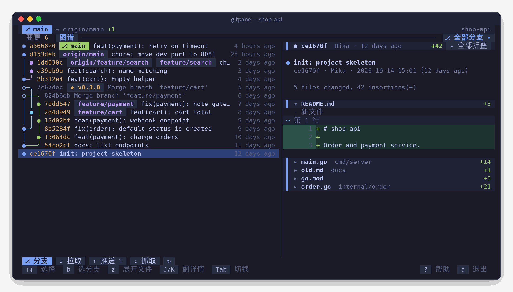
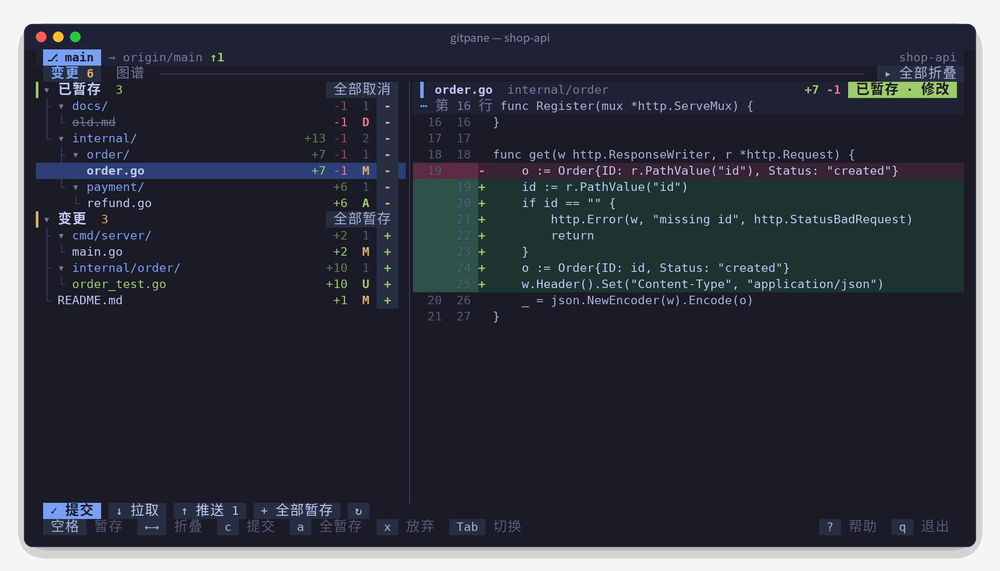
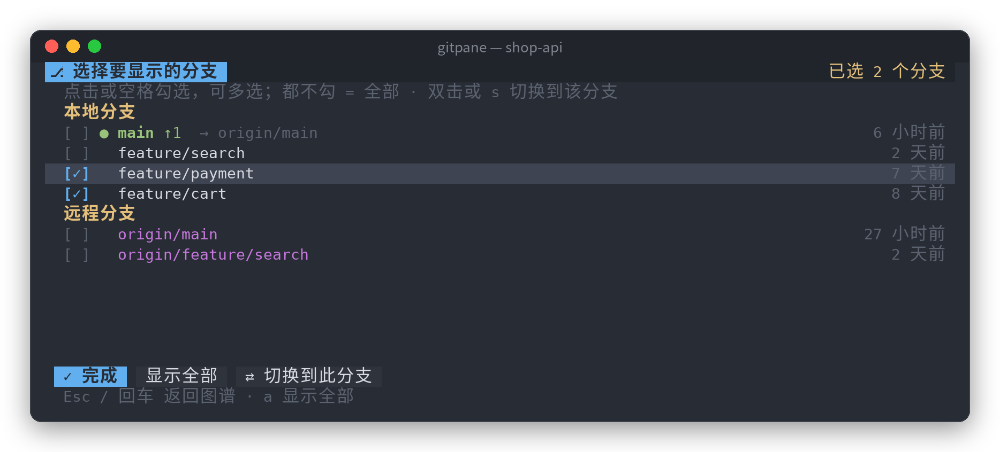

<div align="center">


<h1>Gitpane</h1>

<p><strong>用鼠标就能操作的 Git 终端界面</strong></p>

<p>变更树 · 带行号的 diff · 泳道式提交图谱 · 多分支筛选<br>单个二进制，开箱即用，macOS / Linux / Windows 通用</p>

[](https://github.com/0xBB2B/gitpane/releases)
[](https://github.com/0xBB2B/gitpane/actions/workflows/ci.yml)
[](go.mod)
[](https://goreportcard.com/report/github.com/0xBB2B/gitpane)
[](LICENSE)

<p>
  <b>简体中文</b> ·
  <a href="README.zh-TW.md">繁體中文</a> ·
  <a href="README.en.md">English</a> ·
  <a href="README.ja.md">日本語</a> ·
  <a href="README.ko.md">한국어</a>
</p>

<p>
  <a href="#快速开始">快速开始</a> ·
  <a href="#功能">功能</a> ·
  <a href="#快捷键">快捷键</a> ·
  <a href="#常见问题">常见问题</a> ·
  <a href="#参与贡献">参与贡献</a>
</p>



</div>

## 亮点

- **全程鼠标可点**：点文件看 diff，点 `+` / `-` 暂存，点目录折叠，滚轮翻历史，双击切分支，当然键盘也一样快。
- **真正好看的提交图谱**：自己计算泳道布局，每个提交一行，分叉合并用圆角线在同一行连好，每条分支颜色固定。
- **按分支看历史**：本地、远程分支任意多选，图谱只显示你关心的那几条；滚到底自动加载，整个历史都能翻到。
- **提交详情可折叠**：每个文件一行带 `+增 -删`，点开看改动，多文件提交一眼看清改了哪些。
- **适合陪着 AI 写代码**：每 2 秒自动刷新，Claude Code / Codex 改了什么马上能看到；可以作为面板嵌在分屏一侧。
- **五种界面语言**：简体中文、繁體中文、English、日本語、한국어，按系统语言自动选择，也可以手动指定。
- **不挡路**：不加 git 锁、不弹密码框、只依赖系统里的 `git`。

## 快速开始

**macOS** · Homebrew

```bash
brew tap 0xBB2B/gitpane https://github.com/0xBB2B/gitpane
brew install 0xBB2B/gitpane/gitpane
```

**Windows** · Scoop

```powershell
scoop bucket add gitpane https://github.com/0xBB2B/gitpane
scoop install gitpane
```

**Linux / 从源码**

```bash
go install github.com/0xBB2B/gitpane@latest
```

也可以直接从 [Releases](https://github.com/0xBB2B/gitpane/releases) 下载对应平台的压缩包。

然后进到任意 Git 仓库里运行：

```bash
gitpane
```

按 `?` 查看全部快捷键，`q` 退出。

## 截图

<table>
  <tr>
    <td width="60%"></td>
    <td width="40%"></td>
  </tr>
  <tr>
    <td align="center"><sub>变更：按目录树暂存 / 取消，右侧直接看 diff</sub></td>
    <td align="center"><sub>分支筛选：多选分支，双击切换</sub></td>
  </tr>
</table>

## 用法

```bash
gitpane                  # 当前目录
gitpane ~/code/foo       # 指定目录（仓库里任意子目录都行）
gitpane --lang en        # 指定界面语言：zh-CN / zh-TW / en / ja / ko
gitpane --depth 3        # 当前目录不是仓库时，向下找 3 层子目录里的仓库（默认 2，0 关闭）
gitpane --layout stack   # 强制上下布局；wide 强制左右
gitpane --embed          # 面板模式：q 不退出，Ctrl+C 要按两次（嵌入其他分屏工具时用）
gitpane --version
```

宽度 ≥ 100 列时列表和详情左右并排，更窄时自动变成上下布局。
拖动中间的分隔线（上下布局时拖动详情区的标题栏）可以调整比例，也可以用 `<` `>` 微调、`=` 复位；每个标签页各自记住，下次启动沿用。

## 功能

- **变更**：冲突 / 已暂存 / 变更三组，按目录树展示，每个文件显示 `+增 -删` 和状态字母。
  点文件看 diff，点右侧 `+` / `-` 暂存或取消，点目录的 `+` 整个目录一起，分组标题右侧按钮批量操作。
  暂存后光标自动落到下一个文件。
- **diff**：自绘，带新旧行号、增删行底色、hunk 位置；只渲染可见部分，大文件也不卡。
  长行默认自动换行、完整显示；按 `w` 可以改成截断显示（会记住）。
- **图谱**：自己计算泳道布局，每个提交一行，分叉 / 合并用 `╭ ╮ ╰ ╯ ├ ┤ ┴ ┼` 在同一行连好，每条分支颜色固定；
  `◉` 是 HEAD，`○` 是合并提交（标题淡显）。HEAD / 本地分支 / 远程分支 / 标签分色显示。
  滚到底自动加载更多，整个历史都能翻到。
- **分支筛选**：默认显示全部分支；点标签栏右侧「⎇ 全部分支 ▾」（或按 `b`）打开分支面板，
  本地 / 远程分支都能多选，只看这些分支的历史；点「✕ 全部」恢复。面板里双击或按 `s` 切换到该分支（远程分支会自动建跟踪分支）。
- **提交详情**：提交信息 + 每个文件一行（带 `+增 -删`），点文件名展开 / 折叠它的改动；
  只改一个文件时默认展开，多个文件默认折叠，`z` 或标题栏右侧按钮全部展开 / 折叠。
- **操作**：提交、pull、push（没有上游时自动 `-u origin HEAD`）、fetch、放弃改动（两次确认）、git init。
- **多语言**：界面支持简体中文、繁體中文、English、日本語、한국어。
- **子仓库**：在不是 Git 仓库的目录（比如放了一堆项目的工作区）里启动时，自动在若干层子目录里找仓库；
  只有一个就直接打开，有多个就弹出选择面板（显示每个仓库的分支和改动数，可按 `/` 筛选）。之后按 `o` 或点底部的「⌂ 选择仓库」随时切换。
- **工作树**：用 `git worktree` 并行开发多个分支时，变更页标签栏右侧会出现「⎇ 工作树：分支名 ▾」（或按 `t`），
  列出所有工作树和各自的改动数，切过去就能看、暂存、提交那个工作树里未提交的改动；图谱是共享的，位置和筛选不受影响。
- 每 2 秒自动刷新，外部改了文件（比如 AI 助手在写代码）马上能看到。

## 快捷键

| 键 | 作用 |
|---|---|
| `Tab` `1` `2` | 切换 变更 / 图谱 |
| `j` `k` `↑` `↓` / `g` `G` | 移动 / 到顶到底 |
| `空格` | 暂存 / 取消暂存当前行 |
| `回车` `←` `→` | 折叠 / 展开目录（在文件上按 `←` 回到所在目录） |
| `z` | 变更页：全部折叠 / 展开目录；图谱页：提交详情里全部展开 / 折叠文件 |
| `b` | 打开分支筛选面板（空格勾选、`a` 显示全部、`s` 切换分支、Esc 返回） |
| `o` | 切换子目录里的仓库（在非仓库目录启动时；`/` 筛选，回车打开） |
| `t` | 切换工作树（git worktree），查看各自未提交的改动 |
| `c` | 提交（底部输入框，回车确认，Esc 取消） |
| `a` / `u` | 全部暂存 / 全部取消暂存 |
| `x` | 放弃当前文件改动（按两次确认） |
| `p` / `P` / `f` | pull / push / fetch |
| `J` `K` | 详情区翻页 |
| `w` | 详情区长行自动换行 / 截断（会记住） |
| `<` `>` / `=` | 移动列表和详情之间的分隔线 / 恢复默认比例 |
| `r` | 立即刷新 |
| `?` | 帮助 |
| `q` / `Ctrl+C` | 退出（`--embed` 时 Ctrl+C 按两次） |

## 环境变量

| 变量 | 说明 |
|---|---|
| `GITPANE_LANG` | 界面语言：`zh-CN` / `zh-TW` / `en` / `ja` / `ko`（`--lang` 优先） |
| `GITPANE_DEPTH` | 子仓库探测深度，默认 `2`，`0` 关闭（`--depth` 优先） |
| `GITPANE_THEME` | `dark` / `light`，自动检测不准时手动指定 |
| `GITPANE_NERD_FONT` | 设为 `1` 显示 Nerd Font 文件 / 目录 / 分支图标 |

## 常见问题

**怎么切换界面语言？**
默认按系统语言自动选择（依次看 `LC_ALL`、`LC_MESSAGES`、`LANG`，macOS 和 Windows 还会读系统设置），识别不出来时用简体中文。
想固定某种语言，可以每次加 `--lang en`，或者在 shell 配置里写 `export GITPANE_LANG=ja`（Windows：`setx GITPANE_LANG ko`）。

**和 lazygit / tig 有什么不同？**
Gitpane 更轻：只做最常用的暂存、提交、看 diff、看历史，主打鼠标直接点和好读的提交图谱，适合常驻在分屏一侧。需要 rebase、cherry-pick 等重度操作时，lazygit 依然是更好的选择。

**会不会和其他工具（编辑器、AI 助手）抢 git 锁？**
不会。Gitpane 读状态时设置了 `GIT_OPTIONAL_LOCKS=0`，不会占用 `index.lock`。

**push / pull 需要密码时怎么办？**
Gitpane 设置了 `GIT_TERMINAL_PROMPT=0`，需要密码时会直接报错，而不是把界面卡住。请使用 SSH key 或 credential helper。

**macOS 提示「无法验证开发者」？**
通过 Homebrew 安装会自动处理。如果是手动下载的二进制，运行一次 `xattr -d com.apple.quarantine ./gitpane`。

**Windows 上显示错位或鼠标没反应？**
请使用 [Windows Terminal](https://aka.ms/terminal)，老的 cmd 控制台对鼠标和线框字符支持不完整。

**颜色不对 / 想要图标？**
设置 `GITPANE_THEME=light|dark` 手动指定配色；终端用了 Nerd Font 的话，设置 `GITPANE_NERD_FONT=1` 显示文件图标。

## 项目结构

```
main.go                  命令行参数、版本信息、语言选择
docs/                    Logo 和各语言的截图
.goreleaser.yaml         发布配置（六平台编译、Release、Homebrew cask、Scoop）
.github/workflows/
  ci.yml                 推送 / PR：三系统测试 + 打包演练
  release.yml            推送 v* 标签：正式发布
internal/i18n/           多语言：语言检测 + 各语言翻译表（测试保证没有漏翻）
internal/gitx/           git 命令封装（status、numstat、diff、提交、远程、分支）
  graph.go               提交图谱的泳道布局（带单元测试）
  discover.go            子仓库扫描（带单元测试）
  worktree.go            工作树列表（带单元测试）
internal/ui/
  model.go / update.go   状态、异步加载、键盘鼠标操作
  view.go                布局（上下 / 左右）与渲染；同一个布局函数用于点击命中判断
  diffview.go            diff / 提交详情 / 图谱行的解析与绘制
  picker.go              分支筛选面板
  repos.go               子仓库选择面板与切换
  worktree.go            工作树选择面板与切换
  split.go               列表 / 详情分隔线的拖动与保存
  tree.go                变更文件 → 带连线的目录树
  theme.go               One Monokai / One Light 深浅两套配色、图标
```

## 参与贡献

欢迎 Issue 和 Pull Request。

```bash
git clone https://github.com/0xBB2B/gitpane && cd gitpane
go test ./...        # 单元测试（含提交图谱布局、控制字符清洗、翻译完整性）
go run . ~/some/repo # 本地跑起来
```

提交信息建议使用 [Conventional Commits](https://www.conventionalcommits.org/zh-hans/v1.0.0/)（`feat:`、`fix:`、`docs:` …），Release 的更新日志会据此自动生成。

**翻译**：界面文字在代码里写简体中文原文，用 `i18n.T("…")` 包起来；其他语言的译文在 `internal/i18n/catalog_*.go`。
新增文案后 `go test ./internal/i18n` 会列出缺少的翻译。发现译得不地道，欢迎直接提 PR。

## 发布（维护者）

发布由 GitHub Actions + [GoReleaser](https://goreleaser.com) 自动完成：推送 `v*` 标签后，
编译 macOS / Linux / Windows × amd64 / arm64 六个版本，创建 GitHub Release，
并把 Homebrew cask 写进本仓库的 `Casks/`、Scoop 清单写进 `bucket/`，提交到 `main`。

本仓库同时就是 Homebrew tap 和 Scoop bucket，不需要另建仓库，也不需要额外的 token。

### 注意

- 每次发版后机器人会往 `main` 推一个 `chore: …` 提交，本地下次推送前先 `git pull`。
- 如果给 `main` 开了分支保护，需要允许 GitHub Actions 推送，否则 cask / 清单更新会失败。
- `Casks/` 和 `bucket/` 是生成的，不要手改。

### 每次发版

```bash
git tag v0.1.0
git push origin v0.1.0
```

在 Actions 页面可以看到 release 流程。带 `-rc` / `-beta` 等后缀的标签（如 `v0.2.0-rc1`）
会标成预发布，不推送到 brew / scoop。

### 本地试打包

```bash
goreleaser check                                       # 检查配置
goreleaser release --snapshot --clean --skip=publish   # 只在 dist/ 里生成产物，不发布
```

## 致谢

- [Bubble Tea](https://github.com/charmbracelet/bubbletea) / [Lip Gloss](https://github.com/charmbracelet/lipgloss) / [Bubbles](https://github.com/charmbracelet/bubbles)：终端界面框架
- [One Monokai](https://github.com/azemoh/vscode-one-monokai)、[One Light](https://github.com/atom/atom/tree/master/packages/one-light-syntax)：配色
- [GoReleaser](https://goreleaser.com)：跨平台发布

## 许可

[MIT](LICENSE) © 0xBB2B
