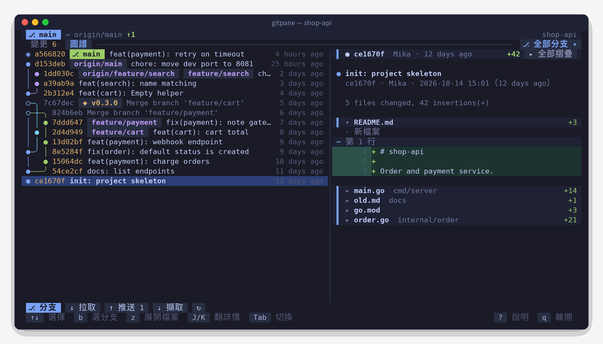
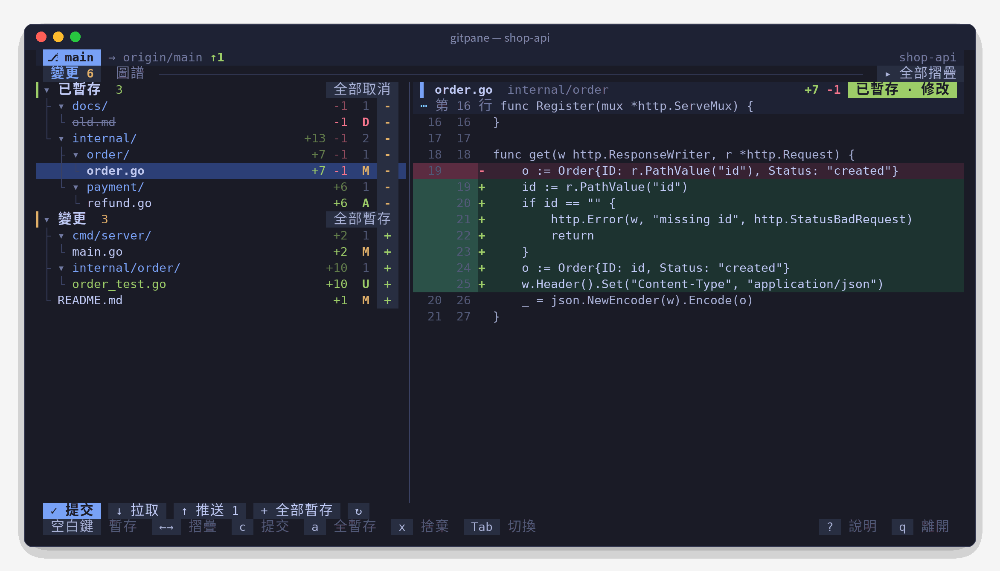
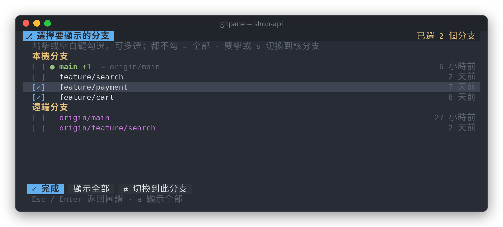

<div align="center">


<h1>Gitpane</h1>

<p><strong>用滑鼠就能操作的 Git 終端機介面</strong></p>

<p>變更樹 · 帶行號的 diff · 泳道式提交圖譜 · 多分支篩選<br>單一執行檔，開箱即用，macOS / Linux / Windows 通用</p>

[](https://github.com/0xBB2B/gitpane/releases)
[](https://github.com/0xBB2B/gitpane/actions/workflows/ci.yml)
[](go.mod)
[](https://goreportcard.com/report/github.com/0xBB2B/gitpane)
[](LICENSE)

<p>
  <a href="README.md">简体中文</a> ·
  <b>繁體中文</b> ·
  <a href="README.en.md">English</a> ·
  <a href="README.ja.md">日本語</a> ·
  <a href="README.ko.md">한국어</a>
</p>

<p>
  <a href="#快速開始">快速開始</a> ·
  <a href="#功能">功能</a> ·
  <a href="#快捷鍵">快捷鍵</a> ·
  <a href="#常見問題">常見問題</a> ·
  <a href="#參與貢獻">參與貢獻</a>
</p>



</div>

## 亮點

- **全程滑鼠可點**：點檔案看 diff，點 `+` / `-` 暫存，點目錄摺疊，滾輪翻閱歷史，雙擊切換分支，當然鍵盤也一樣快。
- **真正好看的提交圖譜**：自行計算泳道佈局，每個提交一行，分岔與合併用圓角線在同一行連好，每條分支顏色固定。
- **依分支看歷史**：本機、遠端分支任意複選，圖譜只顯示你在意的那幾條；捲到底自動載入，整段歷史都能翻到。
- **提交詳情可摺疊**：每個檔案一行並附 `+新增 -刪除`，點開看變更，多檔案的提交一眼看清改了哪些。
- **適合搭配 AI 寫程式**：每 2 秒自動重新整理，Claude Code / Codex 改了什麼馬上看得到；可以當作面板嵌在分割畫面的一側。
- **五種介面語言**：简体中文、繁體中文、English、日本語、한국어，依系統語言自動選擇，也可以手動指定。
- **不擋路**：不加 git 鎖、不跳密碼視窗，只依賴系統裡的 `git`。

## 快速開始

**macOS** · Homebrew

```bash
brew tap 0xBB2B/gitpane https://github.com/0xBB2B/gitpane
brew install 0xBB2B/gitpane/gitpane
```

**Windows** · Scoop

```powershell
scoop bucket add gitpane https://github.com/0xBB2B/gitpane
scoop install gitpane
```

**Linux / 從原始碼**

```bash
go install github.com/0xBB2B/gitpane@latest
```

也可以直接從 [Releases](https://github.com/0xBB2B/gitpane/releases) 下載對應平台的壓縮檔。

接著在任一 Git 儲存庫裡執行：

```bash
gitpane
```

按 `?` 查看全部快捷鍵，`q` 離開。

## 截圖

<table>
  <tr>
    <td width="60%"></td>
    <td width="40%"></td>
  </tr>
  <tr>
    <td align="center"><sub>變更：依目錄樹暫存 / 取消，右側直接看 diff</sub></td>
    <td align="center"><sub>分支篩選：複選分支，雙擊切換</sub></td>
  </tr>
</table>

## 用法

```bash
gitpane                  # 目前目錄
gitpane ~/code/foo       # 指定目錄（儲存庫內任一子目錄都可以）
gitpane --lang zh-TW     # 指定介面語言：zh-CN / zh-TW / en / ja / ko
gitpane --depth 3        # 目前目錄不是儲存庫時，向下尋找 3 層子目錄裡的儲存庫（預設 2，0 關閉）
gitpane --layout stack   # 強制上下排列；wide 強制左右排列
gitpane --embed          # 面板模式：q 不會離開，Ctrl+C 要按兩次（嵌入其他分割畫面工具時使用）
gitpane --version
```

寬度 ≥ 100 欄時清單和詳情左右並排，更窄時自動改成上下排列。
拖曳中間的分隔線（上下排列時拖曳詳情區的標題列）可以調整比例，也可以用 `<` `>` 微調、`=` 復原；每個標籤頁各自記住，下次啟動沿用。

## 功能

- **變更**：衝突 / 已暫存 / 變更三組，以目錄樹呈現，每個檔案顯示 `+新增 -刪除` 和狀態字母。
  點檔案看 diff，點右側 `+` / `-` 暫存或取消，點目錄的 `+` 整個目錄一起，分組標題右側的按鈕可批次操作。
  暫存後游標會自動移到下一個檔案。
- **diff**：自行繪製，含新舊行號、新增 / 刪除行底色、hunk 位置；只繪製可見部分，大檔案也不卡。
  長行預設自動換行、完整顯示；按 `w` 可改為截斷顯示（會記住）。
- **圖譜**：自行計算泳道佈局，每個提交一行，分岔 / 合併用 `╭ ╮ ╰ ╯ ├ ┤ ┴ ┼` 在同一行連好，每條分支顏色固定；
  `◉` 是 HEAD，`○` 是合併提交（標題淡化顯示）。HEAD / 本機分支 / 遠端分支 / 標籤以不同顏色區分。
  捲到底自動載入更多，整段歷史都能翻到。
- **分支篩選**：預設顯示全部分支；點標籤列右側「⎇ 全部分支 ▾」（或按 `b`）開啟分支面板，
  本機 / 遠端分支都能複選，只看這些分支的歷史；點「✕ 全部」還原。在面板裡雙擊或按 `s` 切換到該分支（遠端分支會自動建立追蹤分支）。
- **提交詳情**：提交訊息 + 每個檔案一行（附 `+新增 -刪除`），點檔名展開 / 摺疊它的變更；
  只改一個檔案時預設展開，多個檔案預設摺疊，`z` 或標題列右側按鈕可全部展開 / 摺疊。
- **操作**：提交、pull、push（沒有上游時自動 `-u origin HEAD`）、fetch、捨棄變更（需確認兩次）、git init。
- **多語言**：介面支援简体中文、繁體中文、English、日本語、한국어。
- **子儲存庫**：在不是 Git 儲存庫的目錄（例如放了一堆專案的工作區）啟動時，自動在數層子目錄裡尋找儲存庫；
  只有一個就直接開啟，有多個就跳出選擇面板（顯示每個儲存庫的分支和變更數，可按 `/` 篩選）。之後按 `o` 或點底部的「⌂ 選擇儲存庫」隨時切換。
- 每 2 秒自動重新整理，外部改了檔案（例如 AI 助手正在寫程式）馬上看得到。

## 快捷鍵

| 按鍵 | 作用 |
|---|---|
| `Tab` `1` `2` | 切換 變更 / 圖譜 |
| `j` `k` `↑` `↓` / `g` `G` | 移動 / 跳到頂端或底端 |
| `空白鍵` | 暫存 / 取消暫存目前這一行 |
| `Enter` `←` `→` | 摺疊 / 展開目錄（在檔案上按 `←` 回到所在目錄） |
| `z` | 變更頁：全部摺疊 / 展開目錄；圖譜頁：提交詳情裡全部展開 / 摺疊檔案 |
| `b` | 開啟分支篩選面板（空白鍵勾選、`a` 顯示全部、`s` 切換分支、Esc 返回） |
| `o` | 切換子目錄裡的儲存庫（在非儲存庫目錄啟動時；`/` 篩選，Enter 開啟） |
| `c` | 提交（底部輸入框，Enter 確認，Esc 取消） |
| `a` / `u` | 全部暫存 / 全部取消暫存 |
| `x` | 捨棄目前檔案的變更（按兩次確認） |
| `p` / `P` / `f` | pull / push / fetch |
| `J` `K` | 詳情區翻頁 |
| `w` | 詳情區長行自動換行 / 截斷（會記住） |
| `<` `>` / `=` | 移動清單和詳情之間的分隔線 / 恢復預設比例 |
| `r` | 立即重新整理 |
| `?` | 說明 |
| `q` / `Ctrl+C` | 離開（`--embed` 時 Ctrl+C 要按兩次） |

## 環境變數

| 變數 | 說明 |
|---|---|
| `GITPANE_LANG` | 介面語言：`zh-CN` / `zh-TW` / `en` / `ja` / `ko`（`--lang` 優先） |
| `GITPANE_DEPTH` | 子儲存庫探測深度，預設 `2`，`0` 關閉（`--depth` 優先） |
| `GITPANE_THEME` | `dark` / `light`，自動偵測不準時手動指定 |
| `GITPANE_NERD_FONT` | 設為 `1` 顯示 Nerd Font 檔案 / 目錄 / 分支圖示 |

## 常見問題

**怎麼切換介面語言？**
預設依系統語言自動選擇（依序檢查 `LC_ALL`、`LC_MESSAGES`、`LANG`，macOS 和 Windows 還會讀取系統設定），無法判斷時使用簡體中文。
想固定某種語言，可以每次加上 `--lang zh-TW`，或在 shell 設定檔裡加入 `export GITPANE_LANG=zh-TW`（Windows：`setx GITPANE_LANG zh-TW`）。

**和 lazygit / tig 有什麼不同？**
Gitpane 更輕量：只做最常用的暫存、提交、看 diff、看歷史，主打滑鼠直接點選和易讀的提交圖譜，適合常駐在分割畫面的一側。需要 rebase、cherry-pick 等進階操作時，lazygit 仍是更好的選擇。

**會不會和其他工具（編輯器、AI 助手）搶 git 鎖？**
不會。Gitpane 讀取狀態時設定了 `GIT_OPTIONAL_LOCKS=0`，不會佔用 `index.lock`。

**push / pull 需要密碼時怎麼辦？**
Gitpane 設定了 `GIT_TERMINAL_PROMPT=0`，需要密碼時會直接回報錯誤，而不是讓介面卡住。請使用 SSH 金鑰或 credential helper。

**macOS 提示「無法驗證開發者」？**
透過 Homebrew 安裝會自動處理。如果是手動下載的執行檔，執行一次 `xattr -d com.apple.quarantine ./gitpane`。

**Windows 上畫面錯位或滑鼠沒反應？**
請使用 [Windows Terminal](https://aka.ms/terminal)，舊版 cmd 主控台對滑鼠和框線字元的支援不完整。

**顏色不對 / 想要圖示？**
設定 `GITPANE_THEME=light|dark` 手動指定配色；終端機使用 Nerd Font 的話，設定 `GITPANE_NERD_FONT=1` 顯示檔案圖示。

## 專案結構

```
main.go                  命令列參數、版本資訊、語言選擇
docs/                    Logo 和各語言的截圖
.goreleaser.yaml         發佈設定（六個平台編譯、Release、Homebrew cask、Scoop）
.github/workflows/
  ci.yml                 推送 / PR：三個作業系統測試 + 打包演練
  release.yml            推送 v* 標籤：正式發佈
internal/i18n/           多語言：語言偵測 + 各語言翻譯表（測試確保沒有漏譯）
internal/gitx/           git 指令封裝（status、numstat、diff、提交、遠端、分支）
  graph.go               提交圖譜的泳道佈局（含單元測試）
  discover.go            子儲存庫掃描（含單元測試）
internal/ui/
  model.go / update.go   狀態、非同步載入、鍵盤滑鼠操作
  view.go                版面（上下 / 左右）與繪製；同一個版面函式也用於點擊判定
  diffview.go            diff / 提交詳情 / 圖譜行的解析與繪製
  picker.go              分支篩選面板
  repos.go               子儲存庫選擇面板與切換
  split.go               清單 / 詳情分隔線的拖曳與儲存
  tree.go                變更檔案 → 帶連線的目錄樹
  theme.go               Tokyo Night 深淺兩套配色、圖示
```

## 參與貢獻

歡迎提出 Issue 和 Pull Request。

```bash
git clone https://github.com/0xBB2B/gitpane && cd gitpane
go test ./...        # 單元測試（含提交圖譜佈局、控制字元清理、翻譯完整性）
go run . ~/some/repo # 在本機執行
```

提交訊息建議使用 [Conventional Commits](https://www.conventionalcommits.org/zh-hant/v1.0.0/)（`feat:`、`fix:`、`docs:` …），Release 的更新紀錄會據此自動產生。

**翻譯**：介面文字在程式碼裡以簡體中文原文撰寫，並用 `i18n.T("…")` 包起來；其他語言的譯文在 `internal/i18n/catalog_*.go`。
新增文案後，`go test ./internal/i18n` 會列出缺少的翻譯。發現譯得不夠道地，歡迎直接提 PR。

## 發佈（維護者）

發佈由 GitHub Actions + [GoReleaser](https://goreleaser.com) 自動完成：推送 `v*` 標籤後，
會編譯 macOS / Linux / Windows × amd64 / arm64 六個版本、建立 GitHub Release，
並把 Homebrew cask 寫進本儲存庫的 `Casks/`、Scoop 清單寫進 `bucket/`，提交到 `main`。

本儲存庫同時就是 Homebrew tap 和 Scoop bucket，不需要另外建立儲存庫，也不需要額外的 token。

### 注意

- 每次發佈後機器人會往 `main` 推送一個 `chore: …` 提交，本機下次推送前請先 `git pull`。
- 如果 `main` 有分支保護，需要允許 GitHub Actions 推送，否則 cask / 清單更新會失敗。
- `Casks/` 和 `bucket/` 是自動產生的，請不要手動修改。

### 每次發佈

```bash
git tag v0.1.0
git push origin v0.1.0
```

可以在 Actions 頁面查看發佈流程。帶有 `-rc` / `-beta` 等後綴的標籤（例如 `v0.2.0-rc1`）
會標記為預先發佈，不會推送到 brew / scoop。

### 本機試打包

```bash
goreleaser check                                       # 檢查設定
goreleaser release --snapshot --clean --skip=publish   # 只在 dist/ 產生成品，不發佈
```

## 致謝

- [Bubble Tea](https://github.com/charmbracelet/bubbletea) / [Lip Gloss](https://github.com/charmbracelet/lipgloss) / [Bubbles](https://github.com/charmbracelet/bubbles)：終端機介面框架
- [Tokyo Night](https://github.com/enkia/tokyo-night-vscode-theme)：配色靈感
- [GoReleaser](https://goreleaser.com)：跨平台發佈

## 授權

[MIT](LICENSE) © 0xBB2B
